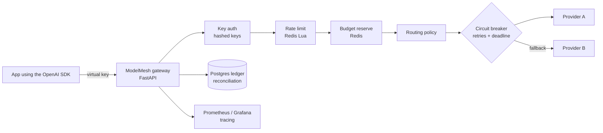

# ModelMesh

**An OpenAI-compatible LLM gateway: per-team keys, routing policy, atomic rate limits and budgets,
automatic failover, and observability. Drop it in by changing one `base_url`.**

Teams call ModelMesh with the official OpenAI SDK. The gateway decides which provider serves each
request, enforces each team's rate limit and spending cap, retries and fails over when a provider
breaks, and records cost, latency and traces. It solves a common platform problem: every team has
its own API keys, no spending limits, no shared view of cost, and an outage at one provider takes
every app down with it.

> Fictional tenant: Órbita Tech (`orbita`), with teams `suporte`, `marketing` and `dados`. Tests and
> demos use mock providers, so no API keys are needed.

## Highlights

- **Atomic limits, no read-modify-write.** RPM, TPM and concurrency limits run as Redis Lua
  scripts. Budgets use reserve-then-reconcile: Redis holds the hot path and Postgres keeps the
  ledger.
- **Resilience patterns, tested under failure:**
  - a shared circuit breaker,
  - retries with jitter,
  - a total request deadline,
  - a bounded fallback chain.
- **Declarative routing policy.** Class aliases such as `cheap` and `smart` map to ordered
  provider chains per team.
- **Virtual keys done right.** Keys are stored hashed, shown exactly once, and revoked
  immediately. Admin auth is separate.
- **Chaos suite with assertions.** 8 failure scenarios, each run and asserted, not just described:
  - provider A fails and B answers,
  - both providers fail,
  - a 429 storm,
  - a slow provider,
  - invalid JSON,
  - missing usage data,
  - Redis down,
  - 200 concurrent requests against a budget.
- **Observability.** Prometheus metrics, tracing, a Grafana dashboard and a React admin panel.

## Verified results

| What | Result |
|---|---|
| 100 concurrent requests against an RPM limit of 50, real Redis 7.4 | **exactly 50 admitted** (re-verified 2026-11-27 against Redis 7.4.12) |
| 200 concurrent requests against a 1 USD budget | final spend **0.99 USD**, 194 rejected with `402`, never overspent |
| Chaos scenarios | **8/8 pass** |
| Forced failure of provider A | first 3 requests fell back to B; once the circuit opened, traffic went straight to B |
| Test suite | 56 passed, plus the real-Redis proof |

**Honest caveat:** the benchmark measured **+218 ms** p50 overhead against direct calls. That was
on localhost with mock providers, fakeredis and SQLite, so it isn't a production number. Real
providers and the budget proof against real Redis plus Postgres under load are still to do. See
[`docs/case-study.md`](docs/case-study.md).

## Architecture



## Tech stack

Python 3.12 · FastAPI · Redis (Lua scripts) · PostgreSQL / SQLite · SQLAlchemy + Alembic ·
Prometheus · Grafana · OpenTelemetry · React 19 + Vite · pytest (fakeredis, pgserver) · Ruff ·
Docker Compose · GitHub Actions

## Quickstart (mock providers, no API keys)

```bash
python -m venv .venv
.venv\Scripts\python -m pip install -r requirements.txt
set MODELMESH_DATABASE_URL=sqlite+aiosqlite:///./.runtime/modelmesh.db
set MODELMESH_ADMIN_TOKEN=<a local admin token>
.venv\Scripts\python -m alembic upgrade head
.venv\Scripts\python -m gateway.app.store.seed

.venv\Scripts\python -m gateway.app.providers.mock_server --name mock_a --port 9001
.venv\Scripts\python -m gateway.app.providers.mock_server --name mock_b --port 9002
.venv\Scripts\python -m uvicorn gateway.app.asgi:app --port 8000
```

Then use it like the OpenAI API, with a key issued by the admin panel:

```python
from openai import OpenAI
client = OpenAI(base_url="http://127.0.0.1:8000/v1", api_key="mm_live_...")
client.chat.completions.create(model="cheap", messages=[{"role": "user", "content": "hello"}])
```

To open the admin panel, run `cd frontend && npm install && npm run dev`, go to
http://localhost:5173 and enter the admin token.

**Full stack with Docker:** postgres, redis, the gateway, two mock providers, Prometheus and
Grafana. Verified on 2026-11-27 from empty volumes:
- every service with a healthcheck reports healthy,
- a chat completion through the gateway returns 200,
- Grafana and Prometheus answer.

The compose file refuses to start without secrets, so set `POSTGRES_PASSWORD`,
`MODELMESH_ADMIN_TOKEN` and `GRAFANA_ADMIN_PASSWORD` in your shell first:

```bash
docker compose up --build --wait     # migrations and demo teams, policies and prices load automatically
```

By design, the gateway has no public port: it sits behind a proxy in production. Grafana
(`127.0.0.1:3000`) and Prometheus (`127.0.0.1:9090`) are published on localhost only.

## Quality checks

```bash
.venv\Scripts\python -m pytest -q                 # unit + integration + real PostgreSQL (pgserver)
.venv\Scripts\python -m pytest -m redis           # needs MODELMESH_TEST_REDIS_URL
.venv\Scripts\python -m chaos.run_chaos           # 8 scenarios; exit 1 if any fails
.venv\Scripts\python -m bench.bench_overhead      # direct vs gateway overhead
.venv\Scripts\python -m ruff check gateway tests chaos bench
```

## Known limitations

- **Mocks only:** no real providers have been tested.
- **Benchmark conditions:** run with fakeredis and SQLite, not production infrastructure.
- **Self-review only:** the security review was done by the author
  ([`docs/security-review.md`](docs/security-review.md)).

## Documentation

- [`docs/architecture.md`](docs/architecture.md), [`docs/decisions.md`](docs/decisions.md),
  [`docs/case-study.md`](docs/case-study.md)
- [`docs/learn/`](docs/learn/) (Portuguese): the OpenAI-compatible API, key hashing, the policy
  engine, retries and jitter, circuit breakers, Redis Lua rate limiting, budget reservation and
  reconciliation, pricing, observability, chaos and benchmarking, plus interview questions.
