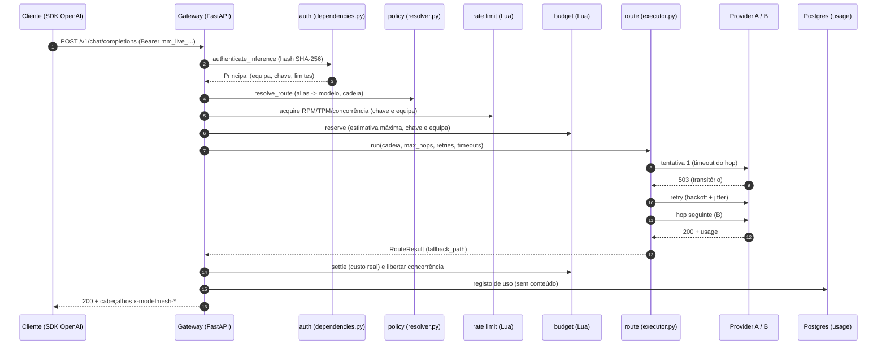

# 00 · Visão geral: o que acontece quando um pedido chega

## O problema

Várias equipas de uma empresa começam a usar LLMs. Cada uma cria as suas chaves, escolhe modelos
ao acaso e ninguém sabe quanto se gasta. Quando um provider falha, as aplicações falham com ele.
O ModelMesh é um gateway compatível com a API da OpenAI que põe um ponto de controlo no meio:
autenticação por equipa, política de modelos, limites, orçamentos, fallback e observabilidade.

## O que entra e o que sai

Entra um pedido `POST /v1/chat/completions` com uma chave virtual. Sai uma resposta no formato da
OpenAI, com cabeçalhos que explicam a decisão tomada. Saída real de um pedido que foi servido pelo
`mock_a` (chave emitida para a equipa `suporte`, modelo pedido `cheap`):

```text
HTTP/1.1 200 OK
x-modelmesh-request-id: req_c4c880043f8a47d9b295b8ed7e1a554a
x-modelmesh-trace-id: 1d7a5cdc7000c1e06ad3c537127adf41
x-modelmesh-requested-model: cheap
x-modelmesh-model: mock-small
x-modelmesh-provider: mock_a
x-modelmesh-fallback-path: mock_a
x-modelmesh-usage-estimated: false
```

O `cheap` é um alias de classe: a política da equipa resolve-o para `mock-small`
(`gateway/app/policy/resolver.py:resolve_route`).

## Como funciona por dentro

O caminho de um pedido é um pipeline explícito. A ordem está em `gateway/app/pipeline.py`:



Cada etapa tem um span OpenTelemetry (`chat.completions`, `policy`, `rate_limit`, `budget.reserve`,
`route`, `provider.attempt`, `budget.reconcile`) em `gateway/app/pipeline.py`.

## Porquê esta escolha

- **Pipeline explícito**: cada etapa tem um motivo para existir e falha de forma previsível. A
  autenticação falha antes de qualquer provider ser contactado.
- **Reservar antes de chamar o provider**: sem reserva, dois pedidos concorrentes podem gastar o
  mesmo orçamento. Ver `07-orcamentos-reserva-reconciliacao.md`.
- **Decisão explicável**: o cliente e o operador vêem qual o modelo, o provider e o caminho de
  fallback. Isto é o que torna o policy engine auditável.

## Alternativas

- **Proxy sem política** (só reencaminhar): simples, mas não controla custo nem falhas.
- **Biblioteca no SDK de cada equipa**: distribui a lógica, cada equipa implementa diferente.
- **LiteLLM como gateway completo**: resolve providers, mas o policy engine próprio, os orçamentos
  atómicos e os testes de chaos são o diferencial deste projeto. Ver `docs/decisions.md`.

## Como falha

- Redis indisponível: o gateway recusa com `503 service_unavailable` (fail-closed).
  Teste: `tests/integration/test_inference.py::test_redis_down_fails_closed_with_503`.
- Todos os hops falham: `503 upstream_unavailable` com a lista de hops tentados.
  Teste: `tests/integration/test_inference.py::test_all_hops_fail_is_503_upstream_unavailable`.

## Perguntas de entrevista

1. **Porque é que a autenticação vem antes da política?** Para não gastar CPU de resolução de
   rotas nem contactar nada com chaves inválidas. Um `401` não toca em providers
   (`test_no_key_is_401_and_never_contacts_provider`).
2. **O que é um "span" e para que serve aqui?** Um intervalo de tempo com atributos dentro de um
   trace. Permite ver em que etapa do pipeline o tempo foi gasto.
3. **Porque é que o gateway devolve `x-modelmesh-fallback-path`?** Torna a decisão visível sem
   logs. Um operador consegue ver que A falhou e B serviu.
