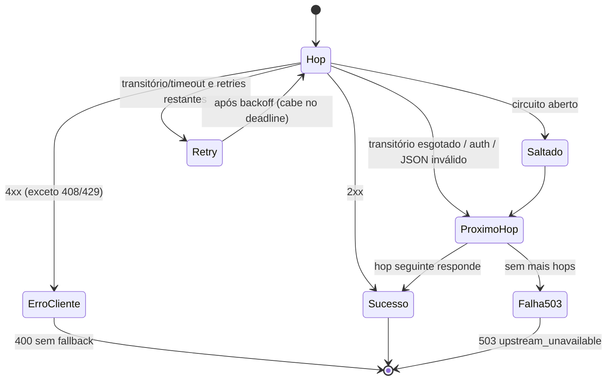

# 03 · Policy engine

## O problema

Cada equipa tem modelos permitidos diferentes, classes de tarefa (`cheap`, `balanced`, `critical`),
cadeias de fallback e limites. Escrever isto em código por equipa não escala.

## O que entra e o que sai

Entra uma política declarativa JSON, validada com Pydantic (`gateway/app/policy/schemas.py:TeamPolicy`).
Sai uma decisão explicável: modelo servido, classe usada e cadeia de hops.

Exemplo de rota efectiva (`GET /admin/routes?team=suporte`), com a política do demo:

```json
{"requested":"cheap","served_model":"mock-small","via_class":"cheap",
 "chain":[{"provider":"mock_a","model":"mock-small"},{"provider":"mock_b","model":"mock-small"}],
 "max_tokens":512}
```

Política inválida devolve `422` e a anterior mantém-se. Resposta real:

```json
{"error":{"message":"a política referencia providers inexistentes","type":"invalid_request_error","code":"validation_error","details":{"unknown_providers":["nope"]}}}
```

## Como funciona por dentro

- `resolve_route` (`gateway/app/policy/resolver.py`) é função pura: classe -> modelo permitido;
  modelo -> cadeia; corta a cadeia a `max_hops`. Sem modelo permitido: `403 model_not_allowed`.
- `TeamPolicy` valida: nomes de modelo que coincidem com classes são rejeitados; classes apontam
  para modelos existentes; `hop_timeout_ms <= timeout_ms`.
- `PUT /admin/policies/{team}` (`gateway/app/api/admin.py:put_policy`) verifica os providers contra a
  configuração e só então grava uma nova versão.
- O motor de execução (`gateway/app/policy/executor.py:RouteExecutor.run`) percorre os hops:
  circuito -> tentativa com timeout -> retries -> próximo hop.



## Porquê esta escolha

- **Política como dados**: muda sem deploy. A validação garante que uma política má nunca entra.
- **Erro de cliente não faz fallback**: um `400` por pedido inválido seria igual em B. Repetir só
  gastava orçamento e latência.
- **Decisão visível**: `x-modelmesh-fallback-path` e `/admin/routes` mostram a mesma resolução.

## Alternativas

- Roteamento por custo ou qualidade: é o projeto CostPilot, fora de âmbito aqui.
- Regras em código por equipa: não auditáveis e lentas a mudar.

## Como falha

- Modelo não permitido: `model_not_allowed` (`test_model_not_allowed_is_403_without_provider_call`).
- Classe sem modelo: `test_class_without_mapping_is_not_allowed`.
- Política inválida mantém a anterior: `test_invalid_policy_rejected_and_previous_kept`.
- A falha, B responde: `test_provider_a_fails_fallback_to_b`. Erro 400: `test_client_error_does_not_fallback`.

## Perguntas de entrevista

1. **Porque é que o fallback não serve para erros de cliente?** O erro é do pedido, não do
   provider. Mandar a B só duplica o custo e o atraso.
2. **O que acontece se a política tiver um provider que não existe?** A gravação é recusada com
   `422`. Não há estado meio aplicado.
3. **Porque a cadeia é limitada a `max_hops`?** Limita o pior caso de latência e de custo: a
   reserva de orçamento tem de cobrir todos os hops possíveis.
