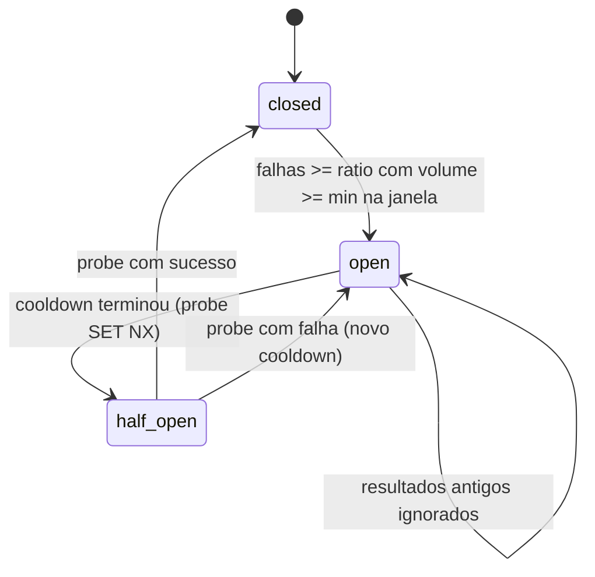

# 05 · Circuit breaker

## O problema

Um provider em baixo faz cada pedido esperar o timeout antes de cair no fallback. Com mil pedidos
por segundo, isso são mil timeouts por segundo a um provider que já não responde.

## O que entra e o que sai

Entram resultados de tentativas (ok ou falha) por `(provider, modelo)`. Sai uma decisão: chamar o
hop ou saltá-lo. O estado é partilhado entre réplicas em Redis
(`gateway/app/policy/lua/circuit_check.lua` e `circuit_record.lua`).

Estados: `closed` (normal), `open` (saltado até ao fim do cooldown), `half_open` (um único pedido
de teste). Abre quando há pelo menos `circuit_min_requests` na janela e a taxa de falhas é igual ou
superior a `circuit_failure_ratio`.

## Como funciona por dentro

- `circuit_check.lua` devolve 1 ou 0. Em `half_open`, o `SET ... NX PX` garante um único probe.
- `circuit_record.lua` mantém duas janelas (`all` e `fail`) e remove entradas fora da janela.
- Resultados de pedidos que partiram antes da abertura não mexem num circuito já aberto.
- Erros de cliente não contam como falha do provider (`CIRCUIT_FAILURE_KINDS`).

Efeito medido: no teste de falhas no `mock_a`, o terceiro pedido salta A e vai diretamente a B
(`tests/integration/test_observability.py::test_fallback_counted_and_traceparent_shared`). Na
browser, o estado do circuito `mock_a / mock-small` aparece como `open` enquanto `mock_b` fica
`closed` (painel, separador "Circuitos e rotas").

## Porquê esta escolha

- **Estado em Redis**: se cada réplica tiver o seu circuito, metade das réplicas continua a bater
  num provider morto. O custo é uma chamada Lua por hop.
- **Taxa e volume, não contagem simples**: cinco falhas num tráfego de mil pedidos por segundo não
  são um incidente; cinco falhas em cinco pedidos talvez sejam.
- **Probe único**: sem ele, ao fim do cooldown, todos os pedidos batiam no provider de uma vez.

## Alternativas

- Circuito por processo: simples, mas não partilhado.
- Timeouts apenas, sem estado: cada pedido paga o timeout.
- Biblioteca externa de circuit breaker: o mesmo problema de estado partilhado exigiria Redis de
  qualquer forma.

## Como falha

- Abertura, salto e recuperação: `test_circuit_opens_skips_then_half_open_recovers`.
- Probe com falha reabre: `test_failed_probe_reopens_circuit`.
- Abaixo do volume mínimo não abre: `test_below_min_requests_circuit_stays_closed`.
- Todos estes testes correm com fakeredis em processo (Lua real via lupa). **Não foram corridos
  contra Redis real**: é pendente registado em `docs/architecture.md`.

## Perguntas de entrevista

1. **Porque é que só um probe passa em half-open?** Se todos passassem, a recuperação de um
   provider ainda instável voltaria a sobrecarregá-lo.
2. **O que acontece se o probe morrer a meio?** A chave do probe tem TTL (`probe_ttl_s`); expira e
   outro probe pode ser feito.
3. **Porque é que o circuito é por modelo e não só por provider?** Um provider pode ter um modelo
   com problemas e outro saudável.
